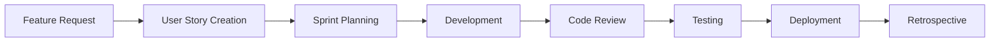

<div align="center">
  <h1>💎 Project Diamonds</h1>
  <p><strong>Comprehensive Event Scheduling & Team Management System</strong></p>
  
  [](https://github.com/SYNCODE-SLIIT/project-diamonds/stargazers)
  [](https://github.com/SYNCODE-SLIIT/project-diamonds/network/members)
  [](https://github.com/SYNCODE-SLIIT/project-diamonds/issues)
  [](https://github.com/SYNCODE-SLIIT/project-diamonds/blob/main/LICENSE)
  
  <p>
    <a href="#-overview">Overview</a> •
    <a href="#-key-features">Features</a> •
    <a href="#-technology-stack">Tech Stack</a> •
    <a href="#-getting-started">Getting Started</a> •
    <a href="#-project-structure">Structure</a> •
    <a href="#-contributing">Contributing</a>
  </p>
</div>

---

## 📋 Table of Contents

- [Overview](#-overview)
- [Business Goals & Motivation](#-business-goals--motivation)
- [Key Features](#-key-features)
- [Technology Stack](#-technology-stack)
- [System Architecture](#-system-architecture)
- [Getting Started](#-getting-started)
  - [Prerequisites](#prerequisites)
  - [Installation](#installation)
  - [Environment Configuration](#environment-configuration)
  - [Running the Application](#running-the-application)
- [Project Structure](#-project-structure)
- [User Roles & Permissions](#-user-roles--permissions)
- [Core Modules](#-core-modules)
- [API Documentation](#-api-documentation)
- [Development Methodology](#-development-methodology)
- [Testing](#-testing)
- [Deployment](#-deployment)
- [Contributing](#-contributing)
- [Team](#-team)
- [License](#-license)

---

## 🌟 Overview

**Project Diamonds** is a comprehensive, web-based event scheduling and team management system developed by **Team Syncode** for **Team Diamonds**, a renowned professional dance team at SLIIT. Built on the powerful MERN (MongoDB, Express.js, React.js, Node.js) stack, this platform serves as a centralized digital solution designed to automate and streamline operational, financial, and administrative tasks.

The system replaces inefficient manual processes—which previously relied on spreadsheets, social media messaging, and scattered communication channels—with a unified, role-based application. It caters to various stakeholders including event organizers, team members, managers, and administrators, providing each with tailored dashboards and functionalities to manage their responsibilities effectively.

### 🎯 Project Objectives

- **Automate 100%** of event booking requests to eliminate manual management
- **Reduce event scheduling conflicts by 80%** through an integrated calendar system
- **Improve team communication response times by 70%** via real-time notifications
- **Decrease administrative workload by 50%** by automating reporting and management tasks

---

## 💼 Business Goals & Motivation

### The Challenge

As Team Diamonds' popularity grew, their manual management methods became a significant bottleneck. The team faced critical challenges including:

#### Key Problems Addressed:

- **Fragmented Processes**: Critical tasks like membership applications, event bookings, and financial tracking were handled separately across platforms like Instagram, WhatsApp, and Excel, leading to data inconsistencies and errors.

- **Inefficient Communication**: Lack of a central communication hub resulted in delays, miscommunication, and difficulties in coordinating schedules between members and managers.

- **Poor User Experience**: Event organizers faced a cumbersome booking process, and prospective members lacked a clear, streamlined application system.

- **Limited Oversight**: Management had no real-time analytics for tracking event performance, finances, or member engagement, hindering data-driven decision-making.

### The Solution

Project Diamonds empowers Team Diamonds by reducing administrative overhead, allowing them to focus on their artistic and creative goals. The platform provides:

✅ Centralized event booking and management  
✅ Automated scheduling with conflict detection  
✅ Real-time financial tracking and reporting  
✅ Integrated team communication  
✅ Data-driven insights and analytics  
✅ Streamlined membership application workflow  

---

## ✨ Key Features

### 🔐 User & Membership Management
- **Invitation-Based Registration**: Unique workflow where applicants submit detailed forms reviewed by Team Managers. Only approved applicants receive account creation links via email.
- **Direct Organizer Registration**: Event organizers can register directly for seamless booking.
- **Secure Authentication**: JWT-based authentication with role-based access control (RBAC).
- **User Profiles**: Comprehensive profile management for all user types.

### 📅 Event Booking & Scheduling
- **Multi-Step Booking Form**: Event organizers can book Team Diamonds through an intuitive booking process.
- **Flexible Packages**: Choose from predefined performance packages or create custom packages.
- **Approval Workflow**: Requests are sent to Team Managers for approval/rejection with real-time status notifications.
- **Integrated Calendar**: Synced calendar prevents scheduling conflicts and keeps everyone updated.
- **Event Assignment**: Managers can assign approved members to specific events.

### 👥 Team Management
- **Member Application Review**: Dedicated dashboard for reviewing membership applications.
- **Practice Scheduling**: Schedule and manage practice sessions with conflict detection.
- **Event Assignment**: Assign team members to approved events based on availability.
- **Performance Tracking**: Monitor member participation and performance metrics.

### 💰 Financial Management
- **Automated Invoice Generation**: Create professional invoices for events automatically.
- **Payment Tracking**: Monitor payment statuses and transaction history.
- **Refund Management**: Handle refund requests efficiently.
- **Expense Tracking**: User-specific expense tracker with budget monitoring.
- **Salary Management**: Log and track salaries as income for team members.
- **Financial Reports**: Generate comprehensive financial reports and analytics.

### 📝 Content & Media Management
- **Blog Management**: Create, edit, and publish blog posts to showcase team activities.
- **Media Galleries**: Update and manage photo/video galleries.
- **Testimonials**: Display client testimonials and success stories.
- **Merchandise Store**: Sell team merchandise with customizable product options.
- **SEO Optimization**: Content optimized for search engines.

### 💬 Communication & Collaboration
- **Real-Time Notifications**: Instant updates for important events and actions.
- **Direct Messaging**: Built-in messaging system for team communication.
- **Group Chats**: Create and manage group conversations.
- **Email Integration**: Automated email notifications for critical updates.

### 📊 Analytics & Reporting
- **Dashboard Analytics**: Real-time insights into team performance, finances, and events.
- **Custom Reports**: Generate detailed reports for various metrics.
- **Data Visualization**: Interactive charts and graphs for better decision-making.
- **Export Functionality**: Export data in PDF and Excel formats.

---

## 💻 Technology Stack

### Frontend
- **React.js** (v19.0.0) - Component-based UI library
- **Tailwind CSS** (v4.0.17) - Utility-first CSS framework
- **Vite** - Next-generation frontend build tool
- **Axios** (v1.8.4) - HTTP client for API requests
- **React Router** - Client-side routing
- **FullCalendar** - Interactive calendar component
- **Chart.js** & **ECharts** - Data visualization
- **Framer Motion** - Animation library
- **Lucide React** - Icon library
- **Material Tailwind** - Material Design components

### Backend
- **Node.js** - JavaScript runtime environment
- **Express.js** (v4.21.2) - Web application framework
- **MongoDB** (v8.13.0) - NoSQL database
- **Mongoose** - MongoDB object modeling
- **JWT** (v9.0.2) - Authentication tokens
- **bcrypt** (v5.1.1) - Password hashing
- **Nodemailer** (v6.10.1) - Email service
- **Multer** - File upload handling
- **Cloudinary** (v1.41.3) - Media management
- **Stripe** (v17.7.0) - Payment processing

### Additional Services
- **Supabase** - Backend as a Service
- **Google Cloud Vision** - Image analysis
- **Tesseract.js** - OCR capabilities
- **PDFKit** & **jsPDF** - PDF generation
- **Validator.js** - Data validation

### Development Tools
- **Git & GitHub** - Version control and collaboration
- **ESLint** - Code linting
- **Nodemon** - Development server
- **dotenv** - Environment variable management

---

## 🏗️ System Architecture

Project Diamonds follows a modern **three-tier architecture**:

```
┌─────────────────────────────────────────────────────────┐
│                     Client Layer                        │
│              (React.js + Tailwind CSS)                  │
│                                                         │
│  ┌──────────┐  ┌──────────┐  ┌──────────┐            │
│  │  User    │  │ Manager  │  │  Admin   │            │
│  │Dashboard │  │Dashboard │  │Dashboard │            │
│  └──────────┘  └──────────┘  └──────────┘            │
└─────────────────────────────────────────────────────────┘
                         ↕ HTTP/HTTPS
┌─────────────────────────────────────────────────────────┐
│                  Application Layer                      │
│              (Node.js + Express.js)                     │
│                                                         │
│  ┌─────────────┐  ┌─────────────┐  ┌─────────────┐   │
│  │   Auth      │  │  Business   │  │   API       │   │
│  │ Middleware  │  │   Logic     │  │  Routes     │   │
│  └─────────────┘  └─────────────┘  └─────────────┘   │
└─────────────────────────────────────────────────────────┘
                         ↕ Mongoose ODM
┌─────────────────────────────────────────────────────────┐
│                    Data Layer                           │
│                    (MongoDB)                            │
│                                                         │
│  ┌──────┐  ┌──────┐  ┌──────┐  ┌──────┐  ┌──────┐   │
│  │Users │  │Events│  │Finance│ │Content│ │Chats │   │
│  └──────┘  └──────┘  └──────┘  └──────┘  └──────┘   │
└─────────────────────────────────────────────────────────┘
```

### External Services Integration
- **Cloudinary**: Media storage and optimization
- **Supabase**: Real-time database and authentication
- **Stripe**: Secure payment processing
- **Google Cloud**: AI/ML capabilities
- **Email Service**: Automated notifications

---

## 🚀 Getting Started

### Prerequisites

Before you begin, ensure you have the following installed:

- **Node.js** (v18.x or higher)
- **npm** (v9.x or higher) or **yarn**
- **MongoDB** (v6.x or higher) - Local installation or MongoDB Atlas account
- **Git** for version control

### Installation

1. **Clone the repository**

```bash
git clone https://github.com/SYNCODE-SLIIT/project-diamonds.git
cd project-diamonds
```

2. **Install dependencies for both frontend and backend**

```bash
# Install root dependencies
npm install

# Install backend dependencies
cd backend
npm install

# Install frontend dependencies
cd ../frontend
npm install
```

### Environment Configuration

#### Backend Environment Variables

Create a `.env` file in the `backend` directory with the following variables:

```env
# Server Configuration
PORT=5000
NODE_ENV=development

# Database Configuration
MONGODB_URI=your_mongodb_connection_string

# JWT Configuration
JWT_SECRET=your_jwt_secret_key
JWT_EXPIRE=7d

# Email Configuration (Nodemailer)
EMAIL_SERVICE=gmail
EMAIL_USER=your_email@gmail.com
EMAIL_PASSWORD=your_app_specific_password

# Cloudinary Configuration
CLOUDINARY_CLOUD_NAME=your_cloud_name
CLOUDINARY_API_KEY=your_api_key
CLOUDINARY_API_SECRET=your_api_secret

# Supabase Configuration
SUPABASE_URL=your_supabase_url
SUPABASE_ANON_KEY=your_supabase_anon_key

# Stripe Configuration
STRIPE_SECRET_KEY=your_stripe_secret_key
STRIPE_PUBLISHABLE_KEY=your_stripe_publishable_key

# Google Cloud Configuration
GOOGLE_APPLICATION_CREDENTIALS=path_to_your_credentials.json
GOOGLE_CLOUD_PROJECT_ID=your_project_id

# Frontend URL (for CORS)
CLIENT_URL=http://localhost:5173
```

#### Frontend Environment Variables

Create a `.env` file in the `frontend` directory:

```env
# API Configuration
VITE_API_URL=http://localhost:5000/api

# Stripe Configuration
VITE_STRIPE_PUBLISHABLE_KEY=your_stripe_publishable_key

# Supabase Configuration
VITE_SUPABASE_URL=your_supabase_url
VITE_SUPABASE_ANON_KEY=your_supabase_anon_key

# Cloudinary Configuration
VITE_CLOUDINARY_CLOUD_NAME=your_cloud_name
VITE_CLOUDINARY_UPLOAD_PRESET=your_upload_preset
```

### Running the Application

#### Development Mode

**Option 1: Run frontend and backend separately**

```bash
# Terminal 1 - Run backend server
cd backend
npm run server  # Uses nodemon for auto-restart

# Terminal 2 - Run frontend development server
cd frontend
npm run dev
```

**Option 2: Run both concurrently (from root directory)**

```bash
# From the root directory
npm run dev  # If configured with concurrently
```

The application will be available at:
- **Frontend**: http://localhost:5173
- **Backend API**: http://localhost:5000

#### Production Mode

```bash
# Build frontend for production
cd frontend
npm run build

# Start backend in production mode
cd ../backend
npm start
```

### Initial Setup

1. **Database Seeding** (Optional)

If you have seed data, run:

```bash
cd backend
npm run seed  # If seed script is configured
```

2. **Hash Existing Passwords** (If migrating data)

```bash
cd backend
npm run hash-passwords
```

3. **Create Admin Account**

Use the application's registration flow or create directly in MongoDB:

```javascript
{
  email: "admin@projectdiamonds.com",
  password: "hashed_password",
  role: "admin",
  isApproved: true
}
```

---

## 📁 Project Structure

```
project-diamonds/
├── backend/                      # Backend application
│   ├── config/                   # Configuration files
│   │   ├── cloudinary.js        # Cloudinary setup
│   │   ├── logoConfig.js        # Logo configuration
│   │   ├── mongodb.js           # MongoDB connection
│   │   └── supabaseClient.js    # Supabase client
│   │
│   ├── controllers/              # Request handlers
│   │   ├── authController.js    # Authentication logic
│   │   ├── eventController.js   # Event management
│   │   ├── financeController.js # Financial operations
│   │   ├── userController.js    # User management
│   │   └── ...                  # Other controllers
│   │
│   ├── middleware/               # Custom middleware
│   │   ├── authmiddleware.js    # JWT authentication
│   │   ├── uploadmiddleware.js  # File upload handling
│   │   └── validateMemberApplication.js
│   │
│   ├── models/                   # Mongoose schemas
│   │   ├── User.js              # User model
│   │   ├── Event.js             # Event model
│   │   ├── Package.js           # Package model
│   │   ├── Transaction.js       # Transaction model
│   │   └── ...                  # Other models
│   │
│   ├── routes/                   # API routes
│   │   ├── authRoutes.js        # Authentication routes
│   │   ├── eventRoutes.js       # Event routes
│   │   ├── financeRoutes.js     # Finance routes
│   │   └── ...                  # Other routes
│   │
│   ├── services/                 # Business logic services
│   ├── scripts/                  # Utility scripts
│   ├── utils/                    # Helper functions
│   ├── uploads/                  # Temporary file uploads
│   ├── server.js                 # Express app setup
│   ├── index.js                  # Server entry point
│   └── package.json              # Backend dependencies
│
├── frontend/                     # Frontend application
│   ├── public/                   # Static assets
│   │   ├── images/              # Image assets
│   │   └── ...
│   │
│   ├── src/                      # Source code
│   │   ├── assets/              # Asset files
│   │   ├── components/          # React components
│   │   │   ├── common/         # Shared components
│   │   │   ├── dashboard/      # Dashboard components
│   │   │   ├── events/         # Event components
│   │   │   ├── finance/        # Finance components
│   │   │   └── ...
│   │   │
│   │   ├── pages/               # Page components
│   │   │   ├── Home.jsx
│   │   │   ├── Dashboard.jsx
│   │   │   ├── Events.jsx
│   │   │   └── ...
│   │   │
│   │   ├── services/            # API service calls
│   │   │   ├── api.js          # Axios instance
│   │   │   ├── authService.js  # Auth API calls
│   │   │   └── ...
│   │   │
│   │   ├── context/             # React Context API
│   │   │   ├── AuthContext.jsx
│   │   │   └── ...
│   │   │
│   │   ├── hooks/               # Custom React hooks
│   │   ├── utils/               # Utility functions
│   │   ├── styles/              # CSS files
│   │   ├── App.jsx              # Root component
│   │   └── main.jsx             # Entry point
│   │
│   ├── index.html               # HTML template
│   ├── vite.config.js           # Vite configuration
│   ├── tailwind.config.js       # Tailwind CSS config
│   ├── eslint.config.js         # ESLint configuration
│   └── package.json             # Frontend dependencies
│
├── .gitignore                   # Git ignore rules
├── package.json                 # Root dependencies
├── README.md                    # This file
└── LICENSE                      # License information
```

---

## 👥 User Roles & Permissions

Project Diamonds implements a comprehensive role-based access control (RBAC) system:

### 1. **Event Organizer**
- Register and create account independently
- Submit event booking requests
- Choose or customize performance packages
- Track booking status in real-time
- Make payments through Stripe
- View invoice history
- Request refunds

### 2. **Team Member**
- Apply for membership (requires manager approval)
- Access personal dashboard
- View assigned events and practices
- Check personal schedule and calendar
- Track personal finances (income/expenses)
- Communicate with team via messaging
- Update personal profile

### 3. **Team Manager**
- Review and approve/reject membership applications
- Send account creation invitations
- Review and approve/reject event requests
- Assign members to events
- Schedule practice sessions
- Monitor team calendar
- Generate financial reports
- Manage team communications

### 4. **Content Manager**
- Create and manage blog posts
- Update media galleries
- Manage testimonials
- Handle merchandise listings
- Customize product offerings
- Update team information

### 5. **Finance Manager**
- Generate invoices automatically
- Track all transactions
- Monitor payment statuses
- Process refund requests
- Manage budgets and expenses
- Generate financial reports
- Track member salaries
- View comprehensive analytics

### 6. **Administrator**
- Full system access
- User management (all roles)
- System configuration
- Database management
- View system logs
- Manage integrations
- Generate system-wide reports

---

## 🧩 Core Modules

### 1. Authentication & Authorization Module
- JWT-based secure authentication
- Role-based access control (RBAC)
- Password encryption using bcrypt
- Session management
- Password reset functionality
- Account verification via email

### 2. User Management Module
- Multi-role user system
- Invitation-based registration for members
- Profile management
- Application review workflow
- User activity tracking
- Account status management

### 3. Event Management Module
- Event booking system
- Package selection (predefined & custom)
- Multi-step booking form
- Approval workflow
- Event assignment
- Calendar integration
- Conflict detection
- Status notifications

### 4. Financial Management Module
- Automated invoice generation
- Payment gateway integration (Stripe)
- Transaction tracking
- Expense management
- Budget monitoring
- Refund processing
- Salary management
- Financial reporting & analytics

### 5. Content Management Module
- Blog post creation & editing
- Media gallery management
- Testimonial showcase
- Merchandise management
- Product customization
- SEO optimization

### 6. Communication Module
- Real-time notifications
- Direct messaging system
- Group chat functionality
- Email integration
- In-app announcements
- Activity feed

### 7. Calendar & Scheduling Module
- Integrated calendar view
- Event scheduling
- Practice session scheduling
- Conflict detection
- Availability management
- Sync across user roles

### 8. Analytics & Reporting Module
- Dashboard analytics
- Custom report generation
- Data visualization (charts & graphs)
- Export functionality (PDF, Excel)
- Performance metrics
- Financial insights

---

## 📚 API Documentation

### Base URL
```
http://localhost:5000/api
```

### Authentication Endpoints

#### Register User
```http
POST /api/auth/register
Content-Type: application/json

{
  "email": "user@example.com",
  "password": "securePassword123",
  "firstName": "John",
  "lastName": "Doe",
  "role": "member"
}
```

#### Login
```http
POST /api/auth/login
Content-Type: application/json

{
  "email": "user@example.com",
  "password": "securePassword123"
}
```

#### Get Current User
```http
GET /api/auth/me
Authorization: Bearer <token>
```

### Event Endpoints

#### Create Event Request
```http
POST /api/events/request
Authorization: Bearer <token>
Content-Type: application/json

{
  "eventName": "Wedding Reception",
  "eventDate": "2025-12-15",
  "venue": "Hotel XYZ",
  "packageId": "package_id",
  "customRequirements": "Special performance"
}
```

#### Get All Events (Manager)
```http
GET /api/events
Authorization: Bearer <token>
```

#### Approve Event
```http
PUT /api/events/:id/approve
Authorization: Bearer <token>
```

### Financial Endpoints

#### Create Invoice
```http
POST /api/finance/invoice
Authorization: Bearer <token>
Content-Type: application/json

{
  "eventId": "event_id",
  "amount": 50000,
  "dueDate": "2025-11-30"
}
```

#### Get Transactions
```http
GET /api/finance/transactions
Authorization: Bearer <token>
```

For complete API documentation, please refer to our [API Documentation](./docs/API.md) (if available) or contact the development team.

---

## 🔄 Development Methodology

Project Diamonds was developed using **Agile (Scrum)** methodology:

### Agile Practices Implemented

1. **Product Backlog Management**
   - All features organized as user stories
   - Prioritized using MoSCoW method (Must Have, Should Have, Could Have, Won't Have)
   - Continuous refinement throughout development

2. **Sprint Planning**
   - Two-week sprint cycles
   - Sprint planning sessions at the beginning of each sprint
   - Daily stand-ups for progress tracking
   - Sprint retrospectives for continuous improvement

3. **Task Management**
   - Kanban board for visual task tracking
   - Task states: To Do → In Progress → Code Review → Testing → Done
   - Regular backlog grooming sessions

4. **Version Control**
   - Feature-based branching strategy
   - Pull request reviews before merging
   - Continuous integration practices

### Development Workflow



---

## 🧪 Testing

### Testing Strategy

1. **Unit Testing**
   - Individual component testing
   - Controller and service testing
   - Utility function testing

2. **Integration Testing**
   - API endpoint testing
   - Database integration testing
   - Third-party service integration

3. **End-to-End Testing**
   - User flow testing
   - Cross-browser testing
   - Responsive design testing

### Running Tests

```bash
# Backend tests
cd backend
npm test

# Frontend tests
cd frontend
npm test

# Coverage report
npm run test:coverage
```

---

## 🌐 Deployment

### Deployment Options

#### Option 1: Traditional Hosting

**Backend Deployment (e.g., Heroku, Railway, Render)**

1. Set environment variables on the hosting platform
2. Configure MongoDB connection string
3. Deploy backend code
4. Verify API endpoints

**Frontend Deployment (e.g., Vercel, Netlify)**

1. Build the production version: `npm run build`
2. Configure environment variables
3. Deploy the `dist` folder
4. Update API URL to production backend

#### Option 2: Containerized Deployment (Docker)

```dockerfile
# Example Dockerfile for backend
FROM node:18-alpine
WORKDIR /app
COPY package*.json ./
RUN npm ci --only=production
COPY . .
EXPOSE 5000
CMD ["npm", "start"]
```

#### Option 3: Cloud Platform (AWS, Google Cloud, Azure)

Follow cloud provider-specific deployment guides for Node.js applications.

### Pre-Deployment Checklist

- [ ] All environment variables configured
- [ ] Database backup created
- [ ] SSL certificates configured
- [ ] CORS settings updated for production
- [ ] API rate limiting implemented
- [ ] Error logging configured
- [ ] Performance optimization completed
- [ ] Security audit passed

---

## 🤝 Contributing

We welcome contributions from the community! Here's how you can help:

### Contribution Guidelines

1. **Fork the Repository**
   ```bash
   git clone https://github.com/YOUR_USERNAME/project-diamonds.git
   ```

2. **Create a Feature Branch**
   ```bash
   git checkout -b feature/AmazingFeature
   ```

3. **Make Your Changes**
   - Follow the existing code style
   - Write meaningful commit messages
   - Add tests for new features
   - Update documentation as needed

4. **Commit Your Changes**
   ```bash
   git add .
   git commit -m "Add: Amazing new feature"
   ```

5. **Push to Your Branch**
   ```bash
   git push origin feature/AmazingFeature
   ```

6. **Open a Pull Request**
   - Provide a clear description of changes
   - Reference any related issues
   - Ensure all tests pass

### Code Style Guidelines

- **JavaScript**: Follow Airbnb JavaScript Style Guide
- **React**: Use functional components and hooks
- **Naming**: Use camelCase for variables, PascalCase for components
- **Comments**: Write clear, concise comments for complex logic
- **Commits**: Use conventional commit messages (feat:, fix:, docs:, etc.)

### Reporting Issues

If you find a bug or have a feature request:

1. Check if the issue already exists
2. Create a new issue with a descriptive title
3. Provide detailed information:
   - Steps to reproduce (for bugs)
   - Expected vs actual behavior
   - Screenshots (if applicable)
   - Environment details

---

## 👨‍💻 Team

**Team Syncode** - Development Team

- **Project Lead**: [Name]
- **Backend Developers**: [Names]
- **Frontend Developers**: [Names]
- **UI/UX Designer**: [Name]
- **QA Engineers**: [Names]

**Client**: Team Diamonds - SLIIT Professional Dance Team

---

## 📄 License

This project is licensed under the MIT License - see the [LICENSE](LICENSE) file for details.

---

## 📞 Contact & Support

For questions, support, or collaboration opportunities:

- **GitHub Issues**: [Project Issues](https://github.com/SYNCODE-SLIIT/project-diamonds/issues)
- **Email**: syncode.sliit@gmail.com
- **Documentation**: [Project Wiki](https://github.com/SYNCODE-SLIIT/project-diamonds/wiki)

---

## 🙏 Acknowledgments

- **Team Diamonds** for their collaboration and feedback
- **SLIIT** for project support
- All open-source libraries and tools that made this project possible
- Contributors and testers who helped improve the system

---

## 📈 Project Status


---

<div align="center">
  <p>Made with ❤️ by Team Syncode</p>
  <p>
    <a href="https://github.com/SYNCODE-SLIIT/project-diamonds">⭐ Star this repo</a> •
    <a href="https://github.com/SYNCODE-SLIIT/project-diamonds/issues">🐛 Report a bug</a> •
    <a href="https://github.com/SYNCODE-SLIIT/project-diamonds/issues">✨ Request a feature</a>
  </p>
</div>
